# CloudHarbor 📋
> **CloudHarbor** 為 CloudPaste 的衍生版本（原專案已停止維護）。來源與授權見 [`ATTRIBUTION.md`](ATTRIBUTION.md)。


<div align="center">
    <p>
    <a href="README_zh-TW.md">繁體中文</a> | <a href="README.md">English</a> |
    <a href="https://www.readme-i18n.com/ozuijoy/cloudharbor?lang=es">Español</a> |
    <a href="https://www.readme-i18n.com/ozuijoy/cloudharbor?lang=fr">français</a> |
    <a href="https://www.readme-i18n.com/ozuijoy/cloudharbor?lang=ja">日本語</a>
    </p>
    
    <h3>🌩️ Serverless 檔案管理與 Markdown 分享工具，支援多種儲存聚合、30+檔案格式線上預覽 與 WebDAV掛載</h3>
</div>

<div align="center">
    <a href="https://deepwiki.com/ozuijoy/cloudharbor"></a>
    <a href="./LICENSE"></a>
    <a href="https://github.com/ozuijoy/cloudharbor/stargazers"></a>
    <a href="https://www.cloudflare.com/"></a>
    <a href="https://hub.docker.com/r/ozuijoy/cloudharbor-backend"></a>
</div>

<p align="center">
  <a href="#-展示">📸 展示</a> •
  <a href="#-特點">✨ 特點</a> •
  <a href="#-部署教程">🚀 部署教程</a> •
  <a href="#-技術棧">🔧 技術棧</a> •
  <a href="#-開發">💻 開發</a> •
  <a href="#-許可證">📄 許可證</a>
</p>

## 📸 部分展示

<table align="center">
  <tr>
    <td>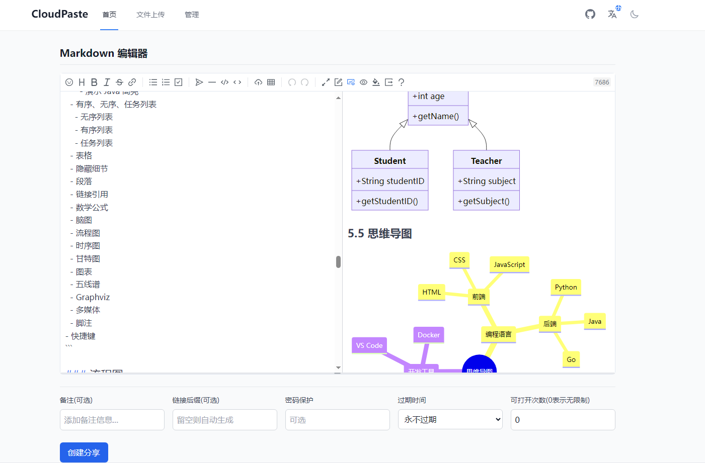</td>
    <td>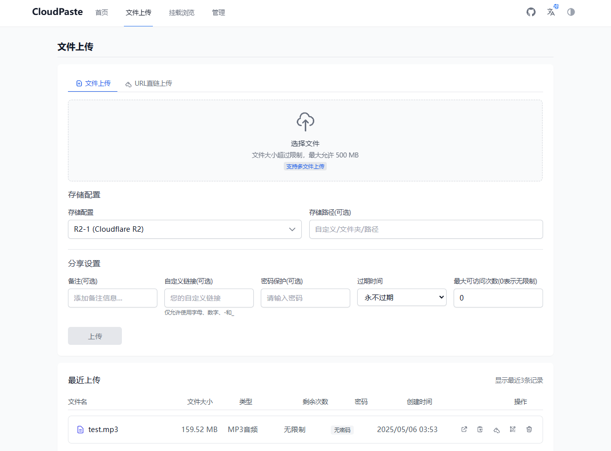</td>
  </tr>
  <tr>
    <td>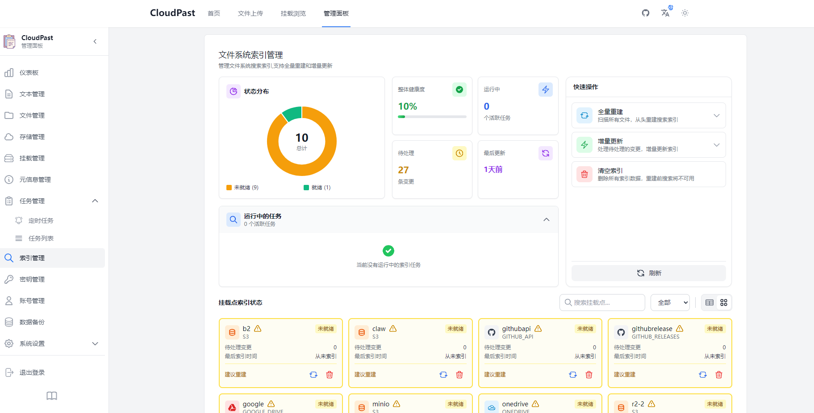</td>
    <td>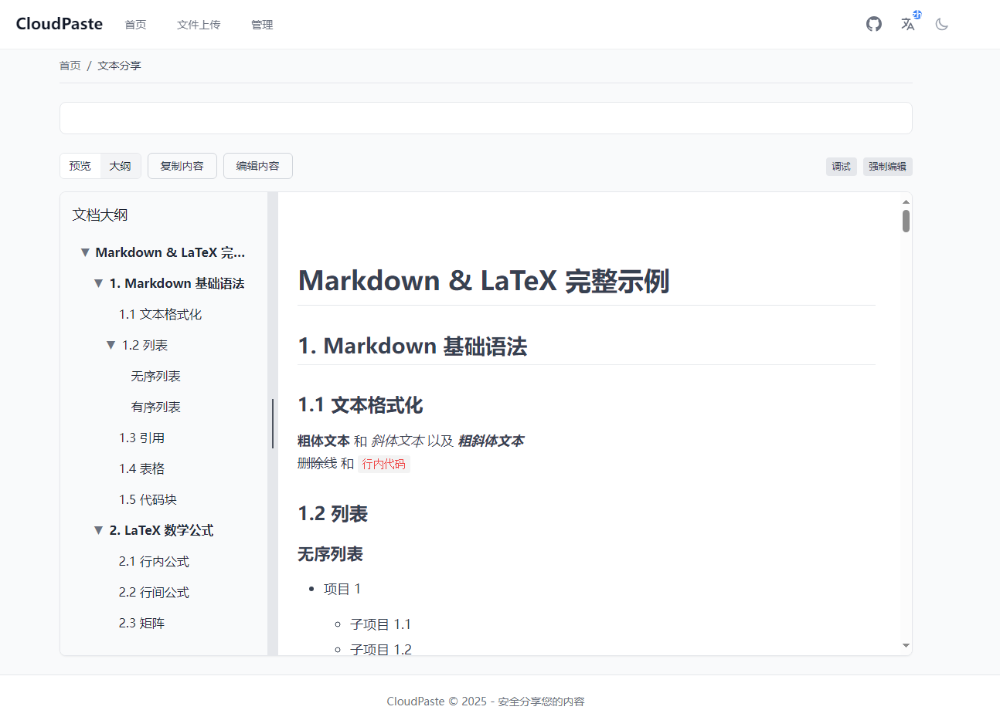</td>
  </tr>
  <tr>
    <td>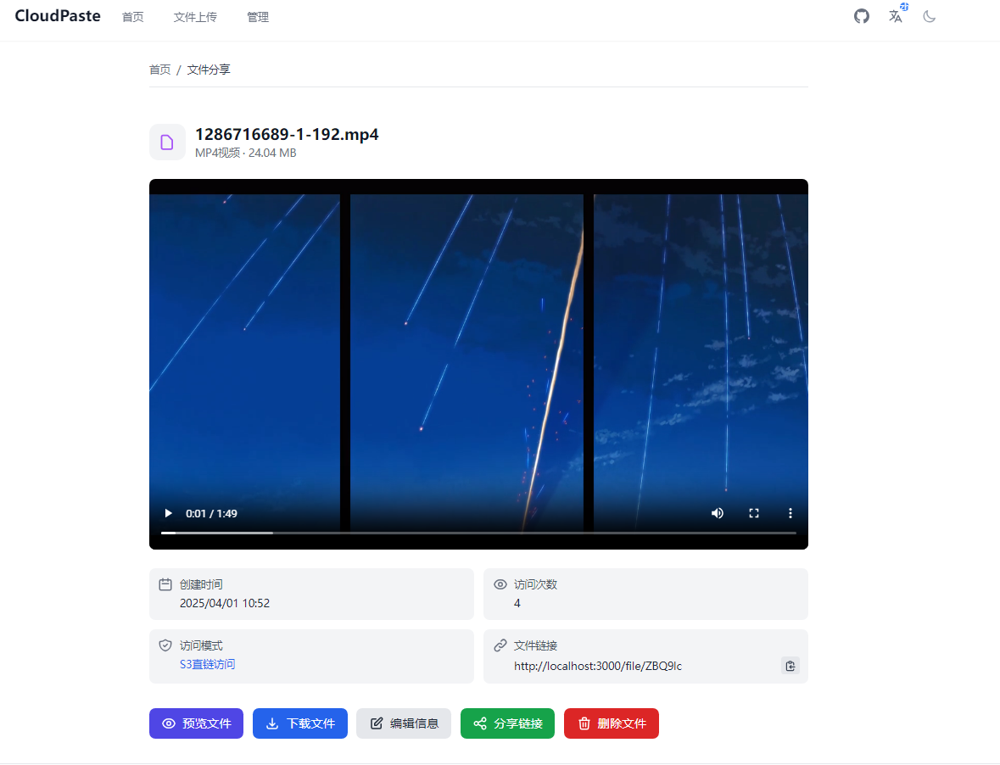</td>
    <td>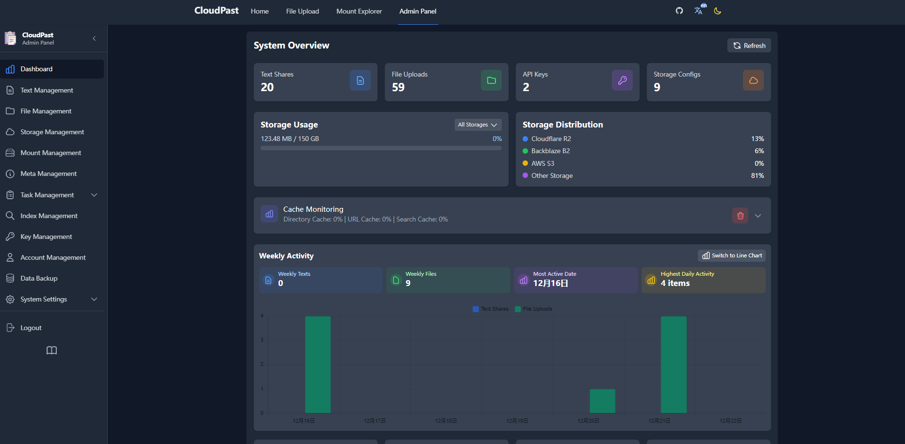</td>
  </tr>
  <tr>
    <td>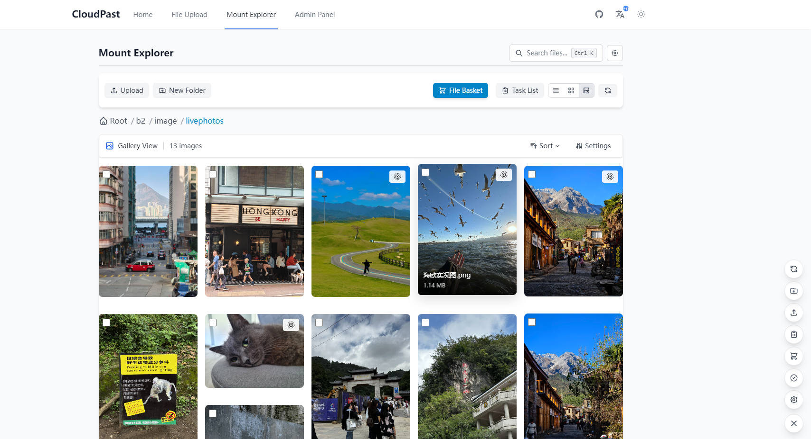</td>
    <td>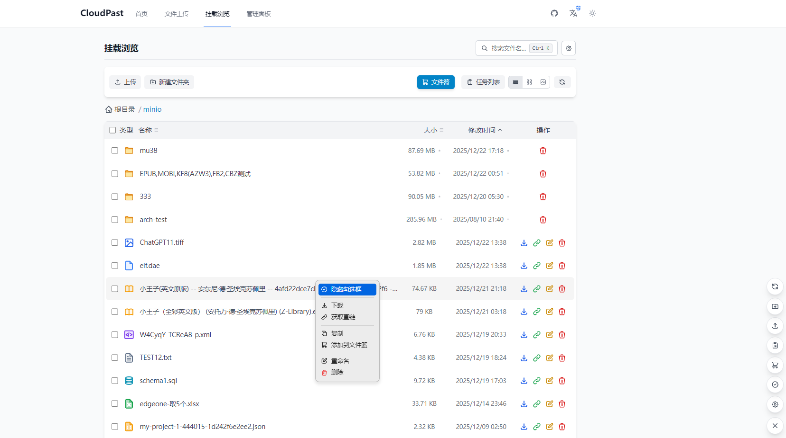</td>
  </tr>
</table>

## ✨ 核心特性

### Cloudflare 原生架構

- **邊緣計算**：基於 Cloudflare Workers 、WorkFlow 和 D1 資料庫，全球 300+ 節點就近響應
- **零運維**：無需管理伺服器，自動擴縮容，按請求計費
- **一體化部署**：前後端打包在同一個 Worker，省心省力
- **分離部署**：可選前後端分離，靈活適配個人需求

### 多儲存支援

- **S3 相容**：Cloudflare R2、Backblaze B2、AWS S3、阿里雲 OSS、騰訊雲 COS、MinIO 等
- **網盤整合**：WebDAV、OneDrive、Google Drive、Telegram、Discord Bot、HuggingFace Database、GitHub API/Releases（只讀）等等
- **本地儲存**：Docker 部署支援本地檔案系統
- **智慧上傳**：前端預簽名直傳 + 流式上傳 +分片斷點續傳，進度實時顯示，最大限度擺脫cf限制
- **檔案預覽**：支援30+種格式直接預覽（圖片、影片、音訊、PDF、Office、程式碼、電子書等），其餘可透過外部IFrame嵌入[KKFileview](https://github.com/kekingcn/kkFileView)預覽
- **定時任務**：支援定時清理上傳會話、儲存同步、搜尋索引重建等自動化任務
- **統一管理**：視覺化配置多儲存，靈活切換預設儲存源

### 強大的 Markdown 編輯器

- **Vditor 整合**：支援 GitHub 風格 Markdown、數學公式、流程圖、思維導圖
- **實時預覽**：所見即所得編輯體驗
- **多格式匯出**：PDF、HTML、PNG、Word 一鍵匯出
- **安全分享**：密碼保護、過期時間、訪問次數限制
- **Raw 直鏈**：類似 GitHub Raw，適合配置檔案託管

### WebDAV 協議支援

- **標準協議**：支援任意 WebDAV 客戶端掛載為網路驅動器
- **完整操作**：目錄建立、檔案上傳、刪除、重新命名、移動
- **許可權控制**：API 金鑰授權，細粒度訪問控制
- **快取最佳化**：可配置 TTL，減少上游請求

### 靈活的許可權管理

- **API 金鑰**：建立多許可權只讀/讀寫金鑰，繫結特定儲存路徑
- **時效控制**：自定義有效期，自動失效與手動撤銷
- **JWT 認證**：安全的管理員認證系統
- **PWA 支援**：可安裝為桌面應用，離線使用

### 多種部署方式

- **自動部署**：GitHub Actions 一鍵部署，支援自動觸發
- **手動部署**：Wrangler CLI 部署，靈活可控
- **Docker 部署**：前後端映象 + Docker Compose 一鍵啟動
- **多平臺**：支援 Cloudflare、Vercel、ClawCloud、HuggingFace 等

## 🚀 部署教程

### 前期準備

在開始部署前，請確保您已準備以下內容：

- [ ] [Cloudflare](https://dash.cloudflare.com) 賬號（必需）
- [ ] 如使用 R2：開通 **Cloudflare R2** 服務並建立儲存桶（需繫結支付方式）
- [ ] 如使用 Vercel：註冊 [Vercel](https://vercel.com) 賬號
- [ ] 其他 S3 儲存服務的配置資訊：
    - `S3_ACCESS_KEY_ID`
    - `S3_SECRET_ACCESS_KEY`
    - `S3_BUCKET_NAME`
    - `S3_ENDPOINT`

**以下教程可能過時 具體參考： [cloudharbor 線上部署文件](https://your-docs.example.com)**

<details>
<summary><b>👉 檢視完整部署教程</b></summary>

### 📑 目錄

- [Action 自動部署](#Action自動部署)
    - [部署架構選擇](#部署架構選擇)
    - [配置 GitHub 倉庫](#配置-GitHub-倉庫)
    - [一體化部署教程（推薦）](#一體化部署教程推薦)
    - [前後端分離部署教程](#前後端分離部署教程)
- [手動部署](#手動部署)
    - [一體化手動部署（推薦）](#一體化手動部署推薦)
    - [前後端分離手動部署](#前後端分離手動部署)
- [ClawCloud 部署 CloudHarbor 教程](#ClawCloud部署CloudHarbor教程)

---

## Action 自動部署

使用 GitHub Actions 可以實現程式碼推送後自動部署應用。CloudHarbor 提供兩種部署架構供您選擇。

### 部署架構選擇

#### 🔄 一體化部署（推薦）

**前後端部署在同一個 Cloudflare Worker 上**

✨ **優勢：**
- **前後端同源** - 無跨域問題，配置更簡單
- **成本更低** - 導航請求不計費，相比分離部署節省 60%+ 成本
- **部署更簡單** - 一次部署完成前後端，無需管理多個服務
- **效能更好** - 前後端在同一 Worker，響應速度更快

#### 🔀 前後端分離部署

**後端部署到 Cloudflare Workers，前端部署到 Cloudflare Pages**

✨ **優勢：**
- **靈活管理** - 前後端獨立部署，互不影響
- **團隊協作** - 前後端可由不同團隊維護
- **擴充套件性強** - 前端可輕鬆切換到其他平臺（如 Vercel）

---

### 配置 GitHub 倉庫

#### 1️⃣ Fork 或克隆倉庫

訪問並 Fork 倉庫：[https://github.com/ozuijoy/cloudharbor](https://github.com/ozuijoy/cloudharbor)

#### 2️⃣ 配置 GitHub Secrets

進入您的 GitHub 倉庫設定：**Settings** → **Secrets and variables** → **Actions** → **New repository secret**

新增以下 Secrets：

| Secret 名稱             | 必需 | 用途                                                  |
| ----------------------- | ---- | ----------------------------------------------------- |
| `CLOUDFLARE_API_TOKEN`  | ✅   | Cloudflare API 令牌（需要 Workers、D1 和 Pages 許可權） |
| `CLOUDFLARE_ACCOUNT_ID` | ✅   | Cloudflare 賬戶 ID                                    |
| `ENCRYPTION_SECRET`     | ❌   | 用於加密敏感資料的金鑰（如不提供，將自動生成）        |
| `ACTIONS_VAR_TOKEN`     | ✅   | 用於部署控制面板的 GitHub Token（使用控制面板時需要，如不使用這不需要） |

#### 3️⃣ 獲取 Cloudflare API 令牌

**獲取 API Token：**

1. 訪問 [Cloudflare API Tokens](https://dash.cloudflare.com/profile/api-tokens)
2. 點選 **Create Token**
3. 選擇 **Edit Cloudflare Workers** 模板
4. **新增額外許可權**：
    - Account → **D1** → **Edit**
    - Account → **Cloudflare Pages** → **Edit** (如使用分離部署)
5. 點選 **Continue to summary** → **Create Token**
6. **複製 Token** 並儲存到 GitHub Secrets

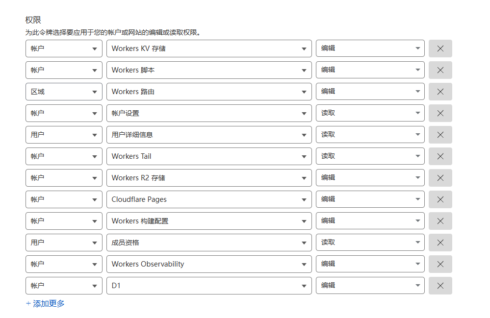

**獲取 Account ID：**

1. 訪問 [Cloudflare Dashboard](https://dash.cloudflare.com)
2. 在右側欄找到 **Account ID**
3. 點選複製並儲存到 GitHub Secrets

#### 4️⃣ （可選）配置部署控制面板

如果您想使用視覺化控制面板管理自動部署開關，需要額外配置：

**建立 GitHub Personal Access Token：**

1. 訪問 [GitHub Token 設定](https://github.com/settings/tokens)
2. 點選 **Generate new token** → **Generate new token (classic)**
3. 設定 Token 名稱（如 `CloudHarbor Deployment Control`）
4. 選擇許可權：
    - ✅ **repo** (完整倉庫訪問許可權)
    - ✅ **workflow** (工作流許可權)
5. 點選 **Generate token**
6. 複製 Token 並儲存為 Secret `ACTIONS_VAR_TOKEN`

**使用控制面板：**

1. 進入倉庫 **Actions** 標籤頁
2. 在左側工作流列表中，點選 **🎛️ 部署控制面板**
3. 點選右側 **Run workflow** → **Run workflow**
4. 在彈出介面中選擇要開啟/關閉的部署方式
5. 點選 **Run workflow** 應用配置
6. 控制面板會在寫入開關狀態後，自動觸發對應的部署工作流一次（是否真正部署由當前開關狀態決定）

---

### 🔄 一體化部署教程（推薦）

#### 部署步驟

1️⃣ **配置完成 GitHub Secrets**（參考上方配置章節）

2️⃣ **觸發部署工作流**

方式一：手動觸發（首次部署推薦）

- 進入倉庫 **Actions** 標籤頁
- 點選左側 **Deploy SPA CF Workers[一體化部署]**
- 點選右側 **Run workflow** → 選擇 `main` 分支 → **Run workflow**

方式二：自動觸發

- 使用部署控制面板開啟 **SPA 一體化自動部署**
- 之後每次推送 `frontend/` 或 `backend/` 目錄的程式碼到 `main` 分支時自動部署

> 提示：在 Actions 頁面手動執行 **Deploy SPA CF Workers[一體化部署]** 工作流時，會強制部署一次，不受自動部署開關影響；自動部署行為（push 或控制面板觸發）始終由 `SPA_DEPLOY` 開關控制。

3️⃣ **等待部署完成**

部署過程約 3-5 分鐘，工作流會自動完成以下步驟：

- ✅ 構建前端靜態資源
- ✅ 安裝後端依賴
- ✅ 建立/驗證 D1 資料庫
- ✅ 初始化資料庫表結構
- ✅ 設定加密金鑰
- ✅ 部署到 Cloudflare Workers

#### 部署完成


**訪問您的應用：** `https://cloudharbor-spa.your-account.workers.dev`

**後續配置：**

1. 首次訪問會自動初始化資料庫
2. 使用預設管理員賬戶登入：
    - 使用者名稱：`admin`
    - 密碼：`admin123`
3. **⚠️ 重要：立即修改預設管理員密碼！**
4. 在管理員面板中配置您的 S3/WEBDAV 相容儲存服務
5. （可選）在 Cloudflare Dashboard 中繫結自定義域名

---

### 🔀 前後端分離部署教程

如果您選擇前後端分離部署，請按以下步驟操作：

#### 後端部署

1️⃣ **配置完成 GitHub Secrets**（參考上方配置章節）

2️⃣ **觸發後端部署**

方式一：手動觸發

- 進入倉庫 **Actions** 標籤頁
- 點選左側 **Deploy Backend CF Workers[Worker後端分離部署]**
- 點選 **Run workflow** → **Run workflow**

方式二：自動觸發

- 使用部署控制面板開啟 **後端分離自動部署**
- 推送 `backend/` 目錄程式碼時自動部署

3️⃣ **等待部署完成**

工作流會自動完成：

- ✅ 建立/驗證 D1 資料庫
- ✅ 初始化資料庫表結構
- ✅ 設定加密金鑰
- ✅ 部署 Worker 到 Cloudflare

4️⃣ **記錄後端地址**

部署成功後記下您的後端 Worker URL：
`https://cloudharbor-backend.your-account.workers.dev`

**<span style="color:red">⚠️ 重要：記住您的後端域名，前端部署時需要使用！</span>**

#### 前端部署

##### Cloudflare Pages

1️⃣ **觸發前端部署**

方式一：手動觸發

- 進入倉庫 **Actions** 標籤頁
- 點選左側 **Deploy Frontend CF Pages[Pages前端分離部署]**
- 點選 **Run workflow** → **Run workflow**

方式二：自動觸發

- 使用部署控制面板開啟 **前端分離自動部署**
- 推送 `frontend/` 目錄程式碼時自動部署

> 提示：在 Actions 頁面手動執行「後端」「前端」部署工作流時，同樣會強制部署一次，不受自動部署開關影響；自動部署行為由 `BACKEND_DEPLOY` / `FRONTEND_DEPLOY` 開關控制。

2️⃣ **配置環境變數**

**必須步驟：前端部署完成後，需要手動配置後端地址！**

1. 登入 [Cloudflare Dashboard](https://dash.cloudflare.com/)
2. 導航到 **Pages** → **cloudharbor-frontend**
3. 點選 **Settings** → **Environment variables**
4. 新增環境變數：
    - **名稱**：`VITE_BACKEND_URL`
    - **值**：您的後端 Worker URL（如 `https://cloudharbor-backend.your-account.workers.dev`）
    - **注意**：末尾不帶 `/`，建議使用自定義域名

**<span style="color:red">⚠️ 必須填寫完整的後端域名，格式：https://xxxx.com</span>**

3️⃣ **重新部署前端**

**重要：配置環境變數後，必須再次執行前端工作流！**

- 返回 GitHub Actions
- 再次手動觸發 **Deploy Frontend CF Pages** 工作流
- 這樣才能載入後端域名配置

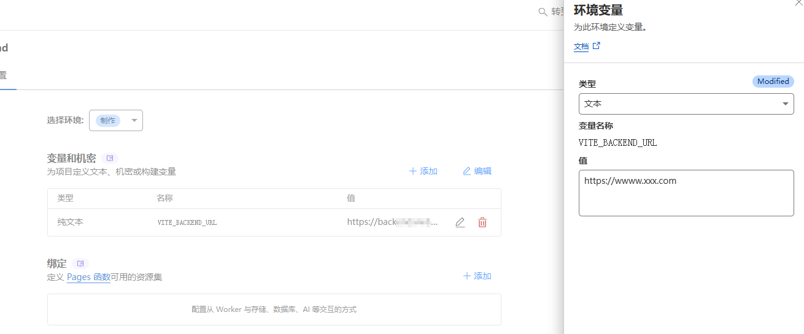

4️⃣ **訪問應用**

前端部署地址：`https://cloudharbor-frontend.pages.dev`

**<span style="color:red">⚠️ 務必嚴格按照步驟操作，否則會出現後端域名載入失敗！</span>**

##### Vercel（備選方案）

Vercel 部署步驟：

1. Fork 後在 Vercel 中匯入 GitHub 專案
2. 配置部署引數：

```
Framework Preset（框架預設）: Vite
Build Command（構建命令）: npm run build
Output Directory（輸出目錄）: dist
Install Command（安裝命令）: npm install
```

3. 配置環境變數：
    - 名稱：`VITE_BACKEND_URL`
    - 值：您的後端 Worker URL
4. 點選 **Deploy** 按鈕進行部署

**☝️ Cloudflare Pages 和 Vercel 二選一即可**

**<span style="color:red">⚠️ 安全提示：請在系統初始化後立即修改預設管理員密碼（使用者名稱: admin, 密碼: admin123）。</span>**

---

## 手動部署

CloudHarbor 支援兩種手動部署方式：一體化部署（推薦）和前後端分離部署。

### 🔄 一體化手動部署（推薦）

一體化部署將前後端部署到同一個 Cloudflare Worker，配置更簡單，成本更低。

#### 步驟 1：克隆倉庫

```bash
git clone https://github.com/ozuijoy/cloudharbor.git
cd CloudHarbor
```

#### 步驟 2：構建前端

```bash
cd frontend
npm install
npm run build
# 或者使用 pnpm（同樣支援）
# pnpm install
# pnpm run build
cd ..
```

**驗證構建產物：** 確保 `frontend/dist` 目錄存在且包含 `index.html`

#### 步驟 3：配置後端

```bash
cd backend
npm install
# 或者使用 pnpm（同樣支援）
# pnpm install
npx wrangler login
```

#### 步驟 4：建立 D1 資料庫

```bash
npx wrangler d1 create cloudharbor-db
```

記下輸出的 `database_id`（例如：`xxxxxxxx-xxxx-xxxx-xxxx-xxxxxxxxxxxx`）

#### 步驟 5：初始化資料庫

```bash
npx wrangler d1 execute cloudharbor-db --file=./schema.sql
```

#### 步驟 6：配置 wrangler.spa.toml

編輯 `backend/wrangler.spa.toml` 檔案，修改資料庫 ID：

```toml
[[d1_databases]]
binding = "DB"
database_name = "cloudharbor-db"
database_id = "您的資料庫ID"  # 替換為步驟4獲取的ID
```

#### 步驟 7：部署到 Cloudflare Workers

```bash
npx wrangler deploy --config wrangler.spa.toml
```

部署成功後，會顯示您的應用 URL：

```
Published cloudharbor-spa (X.XX sec)
  https://cloudharbor-spa.your-account.workers.dev
```

#### 部署完成！

**訪問您的應用：** 開啟上述 URL 即可使用 CloudHarbor

**後續配置：**
1. 首次訪問會自動初始化資料庫
2. 使用預設管理員賬戶登入（使用者名稱：`admin`，密碼：`admin123`）
3. **⚠️ 立即修改預設管理員密碼！**
4. 在管理員面板中配置 S3 相容儲存服務
5. （可選）在 Cloudflare Dashboard 中繫結自定義域名

**<span style="color:red">⚠️ 安全提示：請在系統初始化後立即修改預設管理員密碼。</span>**

---

### 🔀 前後端分離手動部署

如果您需要前後端獨立部署和管理，可以選擇分離部署方式。

#### 後端手動部署

1. 克隆倉庫

```bash
git clone https://github.com/ozuijoy/cloudharbor.git
cd CloudHarbor/backend
```

2. 安裝依賴

   ```bash
   npm install
   ```

3. 登入 Cloudflare

   ```bash
   npx wrangler login
   ```

4. 建立 D1 資料庫

   ```bash
   npx wrangler d1 create cloudharbor-db
   ```

   記下輸出的資料庫 ID。

5. 修改 wrangler.toml 配置

   ```toml
   [[d1_databases]]
   binding = "DB"
   database_name = "cloudharbor-db"
   database_id = "您的資料庫ID"
   ```

6. 部署 Worker

   ```bash
   npx wrangler deploy
   ```

   記下輸出的 URL，這是您的後端 API 地址。

7. 初始化資料庫（自動）
   訪問您的 Worker URL 觸發初始化：

   ```
   https://cloudharbor-backend.your-username.workers.dev
   ```

**<span style="color:red">⚠️ 重要：記住您的後端域名，前端部署時需要使用！</span>**

#### 前端手動部署

#### Cloudflare Pages

1. 準備前端程式碼

   ```bash
   cd CloudHarbor/frontend
   npm install
   ```

2. 配置環境變數
   建立或修改 `.env.production` 檔案：

   ```
   VITE_BACKEND_URL=https://cloudharbor-backend.your-username.workers.dev
   VITE_APP_ENV=production
   VITE_ENABLE_DEVTOOLS=false
   ```

3. 構建前端專案

   ```bash
   npm run build
   ```

   [構建時需注意！！](https://github.com/ozuijoy/cloudharbor/issues)

4. 部署到 Cloudflare Pages

   **方法一**：透過 Wrangler CLI

   ```bash
   npx wrangler pages deploy dist --project-name=cloudharbor-frontend
   ```

   **方法二**：透過 Cloudflare Dashboard

    1. 登入 [Cloudflare Dashboard](https://dash.cloudflare.com/)
    2. 選擇 "Pages"
    3. 點選 "Create a project" → "Direct Upload"
    4. 上傳 `dist` 目錄內的檔案
    5. 設定專案名稱（如 "cloudharbor-frontend"）
    6. 點選 "Save and Deploy"

#### Vercel

1. 準備前端程式碼

   ```bash
   cd CloudHarbor/frontend
   npm install
   ```

2. 安裝並登入 Vercel CLI

   ```bash
   npm install -g vercel
   vercel login
   ```

3. 配置環境變數，與 Cloudflare Pages 相同
4. 構建並部署

   ```bash
   vercel --prod
   ```

   根據提示配置專案。

---

## ClawCloud 部署 CloudHarbor 教程

#### 每月 10G 免費流量，只適合輕度使用

###### Step 1:

註冊連結：[Claw Cloud](https://ap-northeast-1.run.claw.cloud/signin) （不帶#AFF）
不需要信用卡，只要 GitHub 註冊日期大於 180 天，每個月都送 5 美金額度。

###### Step 2:

註冊後，在首頁點選 APP Launchpad 進入，然後點選右上角的 create app


###### Step 3:

先是部署後端，如圖所示（僅供參考）：


後端的資料儲存就是這裡：


###### Step 4:

然後是前端，如圖所示（僅供參考）：


##### 部署完成即可使用，可根據需要自定義域名

</details>

<details>
<summary><b>👉 Docker部署教程</b></summary>

### 📑 目錄

- [Docker 命令列部署](#Docker命令列部署:)
    - [後端 Docker 部署](#後端Docker部署)
    - [前端 Docker 部署](#前端Docker部署)
- [Docker Compose 一鍵部署](#Docker-Compose一鍵部署:)

---

## Docker 命令列部署:

### 後端 Docker 部署

CloudHarbor 後端支援透過官方 Docker 映象快速部署。

1. 建立資料儲存目錄

   ```bash
   mkdir -p sql_data
   ```

2. 執行後端容器

   ```bash
   docker run -d --name cloudharbor-backend \
     -p 8787:8787 \
     -v $(pwd)/sql_data:/data \
     -e ENCRYPTION_SECRET=您的加密金鑰 \
     -e NODE_ENV=production \
     ozuijoy/cloudharbor-backend:latest
   ```

   記下部署的 URL（如 `http://your-server-ip:8787`），後續前端部署需要用到。

**<span style="color:red">⚠️ 安全提示：請務必自定義 ENCRYPTION_SECRET 並儲存好，此金鑰用於加密敏感資料。</span>**

### 前端 Docker 部署

前端使用 Nginx 提供服務，並在啟動時配置後端 API 地址。

```bash
docker run -d --name cloudharbor-frontend \
  -p 80:80 \
  -e BACKEND_URL=http://your-server-ip:8787 \
  ozuijoy/cloudharbor-frontend:latest
```

**<span style="color:red">⚠️ 注意：BACKEND_URL 必須包含完整 URL（包括協議 http:// 或 https://）</span>**
**<span style="color:red">⚠️ 安全提示：請在系統初始化後立即修改預設管理員密碼（使用者名稱: admin, 密碼: admin123）。</span>**

### Docker 映象更新

當專案釋出新版本時，您可以按以下步驟更新 Docker 部署：

1. 拉取最新映象

   ```bash
   docker pull ozuijoy/cloudharbor-backend:latest
   docker pull ozuijoy/cloudharbor-frontend:latest
   ```

2. 停止並移除舊容器

   ```bash
   docker stop cloudharbor-backend cloudharbor-frontend
   docker rm cloudharbor-backend cloudharbor-frontend
   ```

3. 使用上述相同的執行命令啟動新容器（保留資料目錄和配置）

## Docker-Compose 一鍵部署:

使用 Docker Compose 可以一鍵部署前後端服務，是最簡單推薦的方式。

1. 建立 `docker-compose.yml` 檔案

```yaml
version: "3.8"

services:
  frontend:
    image: ozuijoy/cloudharbor-frontend:latest
    environment:
      - BACKEND_URL=https://xxx.com # 填寫後端服務地址
    ports:
      - "8080:80" #"127.0.0.1:8080:80"
    depends_on:
      - backend # 依賴backend服務
    networks:
      - cloudharbor-network
    restart: unless-stopped

  backend:
    image: ozuijoy/cloudharbor-backend:latest
    environment:
      - NODE_ENV=production
      - PORT=8787
      - ENCRYPTION_SECRET=自定義金鑰 # 請修改為您自己的安全金鑰
      - TASK_WORKER_POOL_SIZE=2 # 任務工作池大小
    volumes:
      - ./sql_data:/data # 資料持久化
    ports:
      - "8787:8787" #"127.0.0.1:8787:8787"
    networks:
      - cloudharbor-network
    restart: unless-stopped

networks:
  cloudharbor-network:
    driver: bridge
```

2. 啟動服務

```bash
docker-compose up -d
```

**<span style="color:red">⚠️ 安全提示：請在系統初始化後立即修改預設管理員密碼（使用者名稱: admin, 密碼: admin123）。</span>**

3. 訪問服務

前端: `http://your-server-ip:80`
後端: `http://your-server-ip:8787`

### Docker Compose 更新

當需要更新到新版本時：

1. 拉取最新映象

   ```bash
   docker-compose pull
   ```

2. 使用新映象重新建立容器（保留資料卷）

   ```bash
   docker-compose up -d --force-recreate
   ```

**<span style="color:orange">💡 提示：如果遇到配置變更，可能需要備份資料後修改 docker-compose.yml 檔案</span>**

### Nginx 反代示例（僅供參考）

```nginx
server {
    listen 443 ssl;
    server_name paste.yourdomain.com;  # 替換為您的域名

    # SSL 證書配置
    ssl_certificate     /path/to/cert.pem;  # 替換為證書路徑
    ssl_certificate_key /path/to/key.pem;   # 替換為金鑰路徑

    # 前端代理配置
    location / {
        proxy_pass http://localhost:80;  # Docker前端服務地址
        proxy_set_header Host $host;
        proxy_set_header X-Real-IP $remote_addr;
    }

    # 後端API代理配置
    location /api {
        proxy_pass http://localhost:8787;  # Docker後端服務地址
        proxy_set_header Host $host;
        proxy_set_header X-Real-IP $remote_addr;

        # 上傳相關設定（大檔案上傳必看）
        # - client_max_body_size 0     ：不限制請求body大小
        # - proxy_request_buffering off：請求body直接串流給後端，不先整包緩衝到磁碟
        # - 逾時時間                   ：慢速網路上傳會遠超過nginx預設的60秒
        client_max_body_size 0;
        proxy_request_buffering off;
        proxy_buffering off;
        client_body_timeout 3600s;
        proxy_connect_timeout 3600s;
        proxy_send_timeout 3600s;
        proxy_read_timeout 3600s;

        # WebSocket支援 (如果需要)
        proxy_http_version 1.1;
        proxy_set_header Upgrade $http_upgrade;
        proxy_set_header Connection "upgrade";
    }

    # WebDav 配置
    location /dav/ {
        proxy_pass http://localhost:8787/dav/;  # 指向您的後端服務

        # WebDAV 必要頭資訊
        proxy_set_header Host $host;
        proxy_set_header X-Real-IP $remote_addr;
        proxy_set_header X-Forwarded-For $proxy_add_x_forwarded_for;

        # WebDAV 方法支援
        proxy_pass_request_headers on;

        # 支援所有WebDAV方法
        proxy_method $request_method;

        # 必要的頭資訊處理
        proxy_set_header Destination $http_destination;
        proxy_set_header Overwrite $http_overwrite;

        # 處理大檔案
        client_max_body_size 0;
        client_body_buffer_size 128k;

        # WebDAV 上傳/下載最佳化
        proxy_buffering off;           # 關閉代理緩衝，減少延遲
        proxy_request_buffering off;   # 關閉請求緩衝，讓資料流式傳輸
        proxy_max_temp_file_size 0;    # 不生成臨時檔案
        send_timeout 3600;             # 上傳超時時間
        proxy_read_timeout 3600;       # 讀取超時
        proxy_send_timeout 3600;       # 傳送超時
        proxy_connect_timeout 300;     # 連線超時
    }
}
```

**<span style="color:red">⚠️ 安全提示：建議配置 HTTPS 和反向代理（如 Nginx）以提升安全性。</span>**

</details>

<details>
<summary><b>👉 S3相關跨域配置教程</b></summary>

## R2 API 相關獲取及跨域配置

1. 登入 Cloudflare Dashboard
2. 點選 R2 儲存，建立一個儲存桶。
3. 建立 API 令牌
   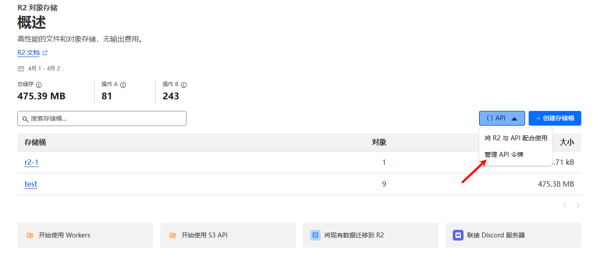
   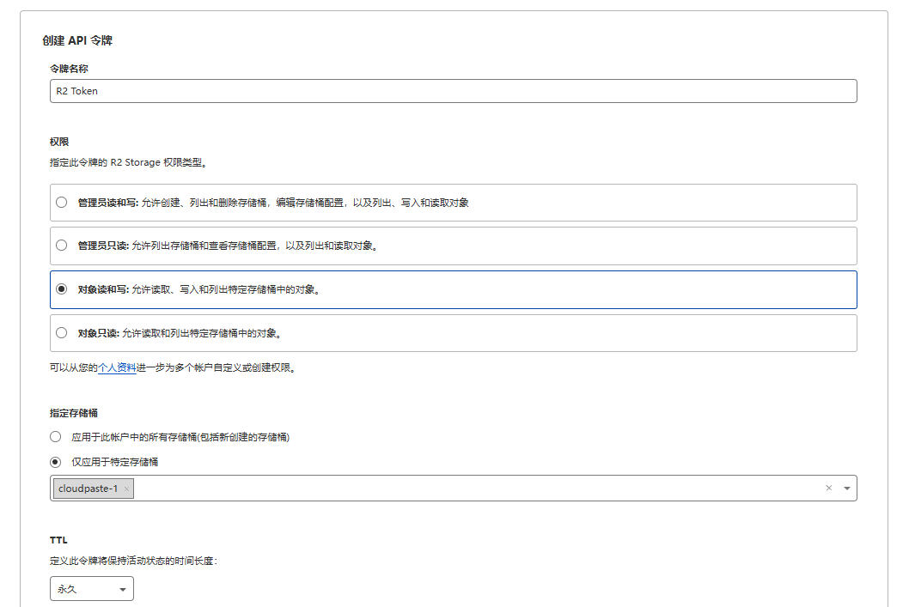

4. 建立後把全部資料都儲存好，後續要用
5. 配置跨域規則，點選對應儲存桶，點選設定，編輯 CORS 策略，如下所示：

```json
[
  {
    "AllowedOrigins": ["http://localhost:3000", "https://根據自己的前端域名來替代"],
    "AllowedMethods": ["GET", "PUT", "POST", "DELETE", "HEAD"],
    "AllowedHeaders": ["*"],
    "ExposeHeaders": ["ETag"],
    "MaxAgeSeconds": 3600
  }
]
```

## B2 API 相關獲取及跨域配置

1. 若沒有 B2 賬號，可以先[註冊](https://www.backblaze.com/sign-up/cloud-storage?referrer=getstarted)一個，然後建立一個儲存桶。
   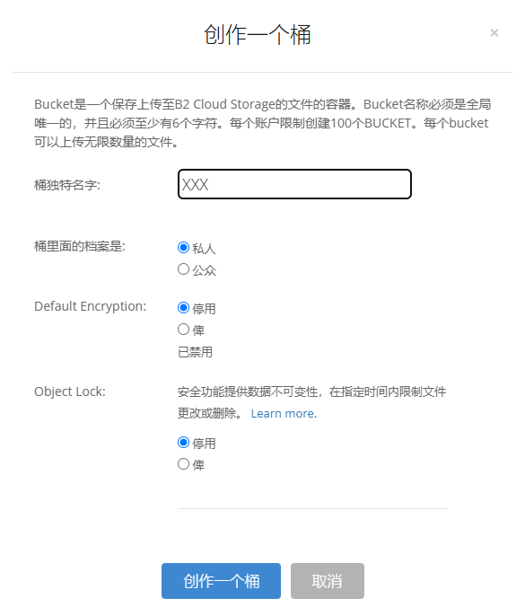
2. 點選側邊欄的 Application Key，點選 Create Key，然後如圖所示。
   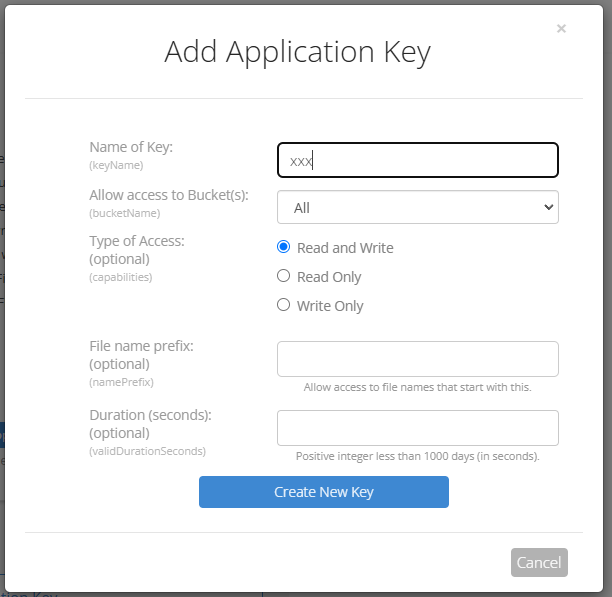
3. 配置 B2 的跨域，B2 跨域配置比較麻煩，需注意
   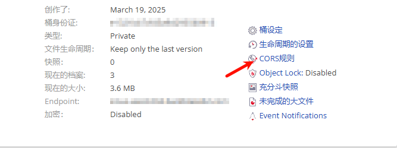
4. 可以先嚐試一下 1 或 2，去到上傳頁面看看是否能上傳，F12 開啟控制檯若顯示跨域錯誤，則使用 3。要一勞永逸就直接使用 3。

   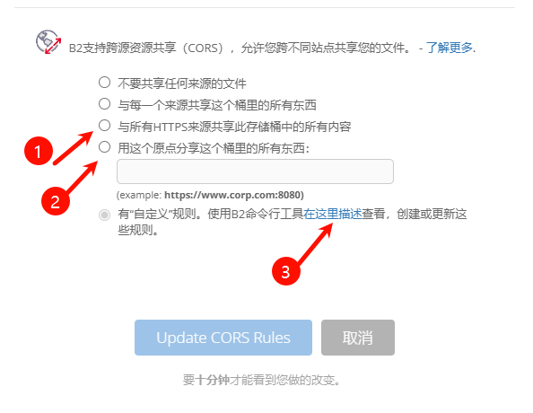

關於 3 的配置由於面板無法配置，只能手動配置，需[下載 B2 CLI](https://www.backblaze.com/docs/cloud-storage-command-line-tools)對應工具。具體可以參考："https://docs.cloudreve.org/zh/usage/storage/b2 " 。

下載後，在對應下載目錄 cmd，在命令列輸入以下命令：

```txt
b2-windows.exe account authorize   //進行賬號登入，根據提示填入之前的 keyID 和 applicationKey
b2-windows.exe bucket get <bucketName> //你可以執行獲取bucket資訊，<bucketName>換成桶名字
```

windows 配置，採用“.\b2-windows.exe xxx”，
所以在對應 cli 的 exe 資料夾中 cmd 輸入，python 的 cli 也同理：

```cmd
b2-windows.exe bucket update <bucketName> allPrivate --cors-rules "[{\"corsRuleName\":\"CloudHarbor\",\"allowedOrigins\":[\"*\"],\"allowedHeaders\":[\"*\"],\"allowedOperations\":[\"b2_upload_file\",\"b2_download_file_by_name\",\"b2_download_file_by_id\",\"s3_head\",\"s3_get\",\"s3_put\",\"s3_post\",\"s3_delete\"],\"exposeHeaders\":[\"Etag\",\"content-length\",\"content-type\",\"x-bz-content-sha1\"],\"maxAgeSeconds\":3600}]"
```

其中<bucketName>換成你的儲存桶名字，關於允許跨域的域名 allowedOrigins 可以根據個人配置，這裡是允許所有。

5. 已完成跨域配置

## MinIO API 相關獲取及跨域配置

1. **部署 MinIO 伺服器**

   使用以下 Docker Compose 配置（參考）快速部署 MinIO 服務：

   ```yaml
   version: "3"

   services:
     minio:
       image: minio/minio:RELEASE.2025-02-18T16-25-55Z
       container_name: minio-server
       command: server /data --console-address :9001 --address :9000
       environment:
         - MINIO_ROOT_USER=minioadmin # 設定管理員使用者名稱
         - MINIO_ROOT_PASSWORD=minioadmin # 設定管理員密碼
         - MINIO_BROWSER=on
         - MINIO_SERVER_URL=https://minio.example.com # S3 API 訪問地址
         - MINIO_BROWSER_REDIRECT_URL=https://console.example.com # 控制檯訪問地址
       ports:
         - "9000:9000" # S3 API 埠
         - "9001:9001" # 控制檯埠
       volumes:
         - ./data:/data
         - ./certs:/root/.minio/certs # 如需配置SSL證書
       restart: always
   ```

   執行 `docker-compose up -d` 啟動服務。

2. **配置反向代理（參考）**

   為確保 MinIO 服務正常工作，特別是檔案預覽功能，需要正確配置反向代理。以下是 OpenResty/Nginx 的推薦配置：

   **MinIO S3 API 反向代理 (minio.example.com)**:

   ```nginx
   location / {
       proxy_pass http://127.0.0.1:9000;
       proxy_set_header Host $host;
       proxy_set_header X-Real-IP $remote_addr;
       proxy_set_header X-Forwarded-For $proxy_add_x_forwarded_for;
       proxy_set_header X-Forwarded-Proto $scheme;

       # HTTP 連線最佳化
       proxy_http_version 1.1;
       proxy_set_header Connection "";  # 啟用HTTP/1.1的keepalive

       # 關鍵配置：解決403錯誤和預覽問題
       proxy_cache off;
       proxy_buffering off;
       proxy_request_buffering off;

       # 無檔案大小限制
       client_max_body_size 0;
   }
   ```

   **MinIO 控制檯反向代理 (console.example.com)**:

   ```nginx
   location / {
       proxy_pass http://127.0.0.1:9001;
       proxy_set_header Host $host;
       proxy_set_header X-Real-IP $remote_addr;
       proxy_set_header X-Forwarded-For $proxy_add_x_forwarded_for;
       proxy_set_header X-Forwarded-Proto $scheme;

       # WebSocket 支援
       proxy_http_version 1.1;
       proxy_set_header Upgrade $http_upgrade;
       proxy_set_header Connection "upgrade";

       # 關鍵配置
       proxy_cache off;
       proxy_buffering off;

       # 無檔案大小限制
       client_max_body_size 0;
   }
   ```

3. **訪問控制檯建立儲存桶和建立訪問金鑰**

   如有詳細配置需求，可參考官方文件：https://min.io/docs/minio/container/index.html

   CN: https://min-io.cn/docs/minio/container/index.html

   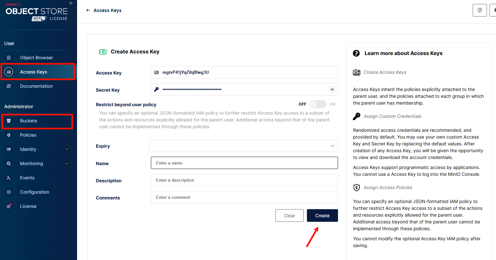

4. **相關配置（可選）**

   允許的源包含您的前端域名
   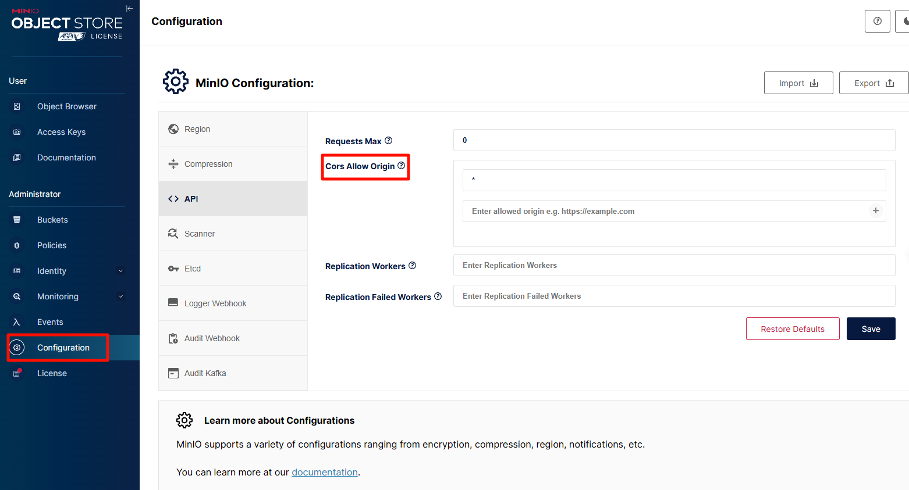

5. **在 CloudHarbor 中配置 MinIO**

    - 登入 CloudHarbor 管理介面
    - 進入 "S3 儲存配置" → "新增儲存配置"
    - 選擇 "其他相容 S3 服務" 作為提供商型別
    - 填入以下資訊：
        - 名稱：自定義名稱
        - 端點 URL：您的 MinIO 服務地址（如 `https://minio.example.com`）
        - 儲存桶名稱：之前建立的儲存桶名稱
        - 訪問金鑰 ID：您的 Access Key
        - 訪問金鑰：您的 Secret Key
        - 區域：可留空
        - 路徑風格訪問：必須啟用！！！！
    - 點選 "測試連線" 確認配置正確
    - 儲存配置

6. **注意與故障排查**

    - **注意事項**：如使用 Cloudfare 開啟 cdn 可能需要加上 proxy_set_header Accept-Encoding "identity"，同時存在快取問題，最好僅用 DNS 解析
    - **403 錯誤**：確保反向代理配置中包含 `proxy_cache off` 和 `proxy_buffering off`
    - **預覽問題**：確保 MinIO 伺服器正確配置了 `MINIO_SERVER_URL` 和 `MINIO_BROWSER_REDIRECT_URL`
    - **上傳失敗**：檢查 CORS 配置是否正確，確保允許的源包含您的前端域名
    - **控制檯無法訪問**：檢查 WebSocket 配置是否正確，特別是 `Connection "upgrade"` 設定

## 更多 S3 相關配置待續......

</details>

<details>
<summary><b>👉 WebDAV配置詳細指南</b></summary>

## WebDAV 配置與使用詳解

CloudHarbor 提供簡易的 WebDAV 協議支援，允許您將儲存空間掛載為網路驅動器，便於直接透過檔案管理器訪問和管理檔案。

### WebDAV 服務基本資訊

- **WebDAV 基礎 URL**: `https://你的後端域名/dav`
- **支援的認證方式**:
    - Basic 認證（使用者名稱+密碼）
- **支援的許可權型別**:
    - 管理員賬戶 - 擁有完整操作許可權
    - API 金鑰 - 按需啟用

### 許可權配置

#### 1. 管理員賬戶訪問

使用管理員賬戶和密碼直接訪問 WebDAV 服務：

- **使用者名稱**: 管理員使用者名稱
- **密碼**: 管理員密碼

#### 2. API 金鑰訪問（推薦）

為更安全的訪問方式，建議建立專用 API 金鑰：

1. 登入管理介面
2. 導航至"API 金鑰管理"
3. 建立新 API 金鑰，**確保啟用"掛載許可權"**
4. 使用方式：
    - **使用者名稱**: API 金鑰值
    - **密碼**: 與使用者名稱相同的 API 金鑰值

### NGINX 反向代理配置

如果使用 NGINX 作為反向代理，需要新增特定的 WebDAV 配置以確保所有 WebDAV 方法正常工作：

```nginx
# WebDAV 配置
location /dav {
    proxy_pass http://localhost:8787;  # 指向您的後端服務

    # WebDAV 必要頭資訊
    proxy_set_header Host $host;
    proxy_set_header X-Real-IP $remote_addr;
    proxy_set_header X-Forwarded-For $proxy_add_x_forwarded_for;

    # WebDAV 方法支援
    proxy_pass_request_headers on;

    # 支援所有WebDAV方法
    proxy_method $request_method;

    # 必要的頭資訊處理
    proxy_set_header Destination $http_destination;
    proxy_set_header Overwrite $http_overwrite;

    # 處理大檔案
    client_max_body_size 0;

    # 超時設定
    proxy_connect_timeout 3600s;
    proxy_send_timeout 3600s;
    proxy_read_timeout 3600s;
}
```

### 常見問題解決

1. **連線問題**:

    - 確認 WebDAV URL 格式正確
    - 驗證認證憑據是否有效
    - 檢查 API 金鑰是否具有掛載許可權

2. **許可權錯誤**:

    - 確認賬戶具有所需的許可權
    - 管理員賬戶應有完整許可權
    - API 金鑰需特別啟用掛載許可權

3. **⚠️⚠️ Webdav 上傳問題**:

    - Worker 部署的 webdav 上傳大小可能受限於 CF 的 CDN 限制 100MB 左右，導致報錯 413
    - 對於 Docker 部署，只需注意 nginx 代理配置，上傳模式任意。

</details>

## 🔧 技術棧

### 前端

- **框架**: Vue.js 3 + Vite
- **樣式**: TailwindCSS
- **編輯器**: Vditor
- **國際化**: Vue-i18n
- **圖表**: Chart.js + Vue-chartjs

### 後端

- **執行時**: Cloudflare Workers
- **框架**: Hono
- **資料庫**: Cloudflare D1 (SQLite)
- **儲存**: 多 S3 相容服務 (支援 R2, B2, AWS S3)
- **認證**: JWT 令牌 + API 金鑰

## 💻 開發

### API 文件

[API 文件](Api-doc.md)

[伺服器 檔案直傳 API 文件](Api-s3_direct.md) - 伺服器 檔案直傳介面詳細說明

### 本地開發設定

1. **克隆專案倉庫**

   ```bash
   git clone https://github.com/ozuijoy/cloudharbor.git
   cd cloudharbor
   ```

2. **後端設定**

   ```bash
   cd backend
   npm install
   # 初始化 D1 資料庫
   wrangler d1 create cloudharbor-db
   wrangler d1 execute cloudharbor-db --file=./schema.sql
   ```

3. **前端設定**

   ```bash
   cd frontend
   npm install
   ```

4. **配置環境變數**

    - 在 `backend` 目錄下，建立 `wrangler.toml` 檔案設定開發環境變數
    - 在 `frontend` 目錄下，配置 `.env.development` 檔案設定前端環境變數

5. **啟動開發伺服器**

   ```bash
   # 後端
   cd backend
   npm run dev

   # 前端 (另一個終端)
   cd frontend
   npm run dev
   ```

### 專案結構

```
CloudHarbor/
├── frontend/                         # 前端 Vite + Vue 3 SPA
│   ├── src/
│   │   ├── api/                      # HTTP 客戶端與 API service（無領域語義）
│   │   ├── modules/                  # 領域模組層（按業務拆分）
│   │   │   ├── paste/                # 文字分享（編輯器 / 公共檢視 / 管理）
│   │   │   ├── fileshare/            # 檔案分享（公共頁 / 管理）
│   │   │   ├── fs/                   # 掛載檔案系統瀏覽器（MountExplorer）
│   │   │   ├── upload/               # 上傳控制器與上傳檢視
│   │   │   ├── storage-core/         # 儲存驅動與 Uppy 整合（底層抽象）
│   │   │   ├── security/             # 前端認證橋接 / 請求頭構造
│   │   │   ├── pwa-offline/          # PWA 離線與佇列
│   │   │   └── admin/                # 管理後臺（儀表盤 / 設定 / 金鑰管理等）
│   │   ├── components/               # 可複用通用元件（對模組無依賴）
│   │   ├── composables/              # 共享組合式 API（file-system / preview 等）
│   │   ├── stores/                   # Pinia Store（auth / fileSystem / siteConfig 等）
│   │   ├── router/                   # Vue Router 配置（所有頁面路由入口）
│   │   ├── pwa/                      # PWA 狀態與安裝提示
│   │   ├── utils/                    # 通用工具函式（clipboard / time / icons 等）
│   │   ├── styles/                   # 全域性樣式與 Tailwind 配置入口
│   │   └── assets/                   # 靜態資源
│   ├── eslint.config.cjs             # 前端 ESLint 配置（含 import 限制）
│   ├── vite.config.js                # Vite 構建配置
│   └── package.json
├── backend/                          # 後端（Cloudflare Workers / Docker 雙執行模式）
│   ├── src/
│   │   ├── routes/                   # HTTP 路由層（fs / files / pastes / admin / system 等）
│   │   │   ├── fs/                   # 掛載檔案系統 API（list / read / write / search / share）
│   │   │   ├── files/                # 檔案分享 API（公開 / 管理）
│   │   │   ├── pastes/               # 文字分享 API（公開 / 管理）
│   │   │   ├── adminRoutes.js        # 管理端通用路由
│   │   │   ├── apiKeyRoutes.js       # API 金鑰管理路由
│   │   │   ├── mountRoutes.js        # 掛載點配置路由
│   │   │   ├── systemRoutes.js       # 系統設定與儀表盤統計
│   │   │   └── fsRoutes.js           # 統一 FS 入口聚合
│   │   ├── services/                 # 領域服務（pastes / files / system / apiKey 等）
│   │   ├── security/                 # 認證 + 授權層（AuthService / securityContext / authorize / policies）
│   │   ├── webdav/                   # WebDAV 協議實現與路徑處理
│   │   ├── storage/                  # 儲存抽象（S3 驅動、掛載管理、檔案系統操作）
│   │   ├── repositories/             # 資料訪問層（D1 + SQLite Repository）
│   │   ├── cache/                    # 快取與失效（主要用於 FS）
│   │   ├── constants/                # 常量定義（ApiStatus / Permission / DbTables / UserType 等）
│   │   ├── http/                     # 統一錯誤型別與響應封裝
│   │   └── utils/                    # 通用工具（common / crypto / environment 等）
│   ├── schema.sql                    # D1 / SQLite 資料庫初始化指令碼
│   ├── wrangler.toml                 # Cloudflare Workers / D1 配置
│   └── package.json
├── docker/                           # Docker 與 Compose 部署配置
├── images/                           # README 中使用的截圖資源
├── Api-doc.md                        # API 總覽文件
├── Api-s3_direct.md                  # S3 直傳相關 API 文件
└── README.md                         # 當前專案說明文件
```

### 自定義 Docker 構建

如果您希望自定義 Docker 映象或進行開發除錯，可以按照以下步驟手動構建：

1. **構建後端映象**

   ```bash
   # 在專案根目錄執行
   docker build -t cloudharbor-backend:custom -f docker/backend/Dockerfile .

   # 執行自定義構建的映象
   docker run -d --name cloudharbor-backend \
     -p 8787:8787 \
     -v $(pwd)/sql_data:/data \
     -e ENCRYPTION_SECRET=開發測試金鑰 \
     cloudharbor-backend:custom
   ```

2. **構建前端映象**

   ```bash
   # 在專案根目錄執行
   docker build -t cloudharbor-frontend:custom -f docker/frontend/Dockerfile .

   # 執行自定義構建的映象
   docker run -d --name cloudharbor-frontend \
     -p 80:80 \
     -e BACKEND_URL=http://localhost:8787 \
     cloudharbor-frontend:custom
   ```

3. **開發環境 Docker Compose**

   建立 `docker-compose.dev.yml` 檔案：

   ```yaml
   version: "3.8"

   services:
     frontend:
       build:
         context: .
         dockerfile: docker/frontend/Dockerfile
       environment:
         - BACKEND_URL=http://backend:8787
       ports:
         - "80:80"
       depends_on:
         - backend

     backend:
       build:
         context: .
         dockerfile: docker/backend/Dockerfile
       environment:
         - NODE_ENV=development
         - RUNTIME_ENV=docker
         - PORT=8787
         - ENCRYPTION_SECRET=dev_secret_key
       volumes:
         - ./sql_data:/data
       ports:
         - "8787:8787"
   ```

   啟動開發環境：

   ```bash
   docker-compose -f docker-compose.yml up --build
   ```

## 📄 許可證

Apache License 2.0

本專案使用 Apache License 2.0 許可證 - 詳情請參閱 [LICENSE](LICENSE) 檔案。

## ❤️ 貢獻

- **Contributors**：感謝以下貢獻者對本專案的無私貢獻！

  [](https://github.com/ozuijoy/cloudharbor/graphs/contributors)

## Star History

[](https://star-history.com/#ozuijoy/cloudharbor&Date)

**如果覺得專案不錯希望您能給個免費的 star✨✨，非常感謝！**
